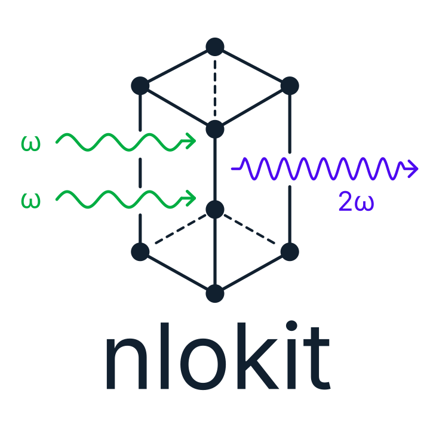
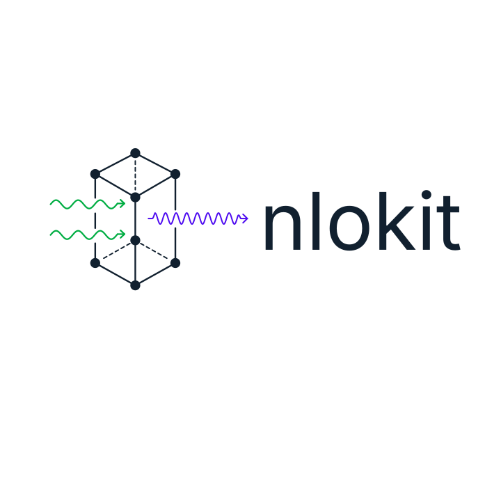

# NLOkit brand assets

This directory contains the current SVG logos for the [NLOkit](https://github.com/NLOkit) organization and its software projects.

| File | Use |
| --- | --- |
| [`nlokit-logo.svg`](nlokit-logo.svg) | Full logo with wordmark, for project READMEs, scientific posters, and documentation. |
| [`nlokit-icon.svg`](nlokit-icon.svg) | Compact symbol without wordmark, for software icons and small displays. |
| [`nlokit-horizontal.svg`](nlokit-horizontal.svg) | Horizontal logo, for banners, presentation headers, and websites. |

## Previews

**Full logo**



**Icon**


**Horizontal logo**



## Reusing the assets

Reference the published files using stable repository paths:

```markdown

```

For web pages, you can use the [compact icon](https://raw.githubusercontent.com/NLOkit/.github/main/assets/nlokit-icon.svg) or the [horizontal logo](https://raw.githubusercontent.com/NLOkit/.github/main/assets/nlokit-horizontal.svg) in the same way.

These assets are public, including when they are referenced from private NLOkit repositories. The editable PowerPoint source and PNG export versions are maintained separately; use the SVGs for resolution-independent display. The GitHub organization **profile picture** must still be uploaded separately in the organization settings.
